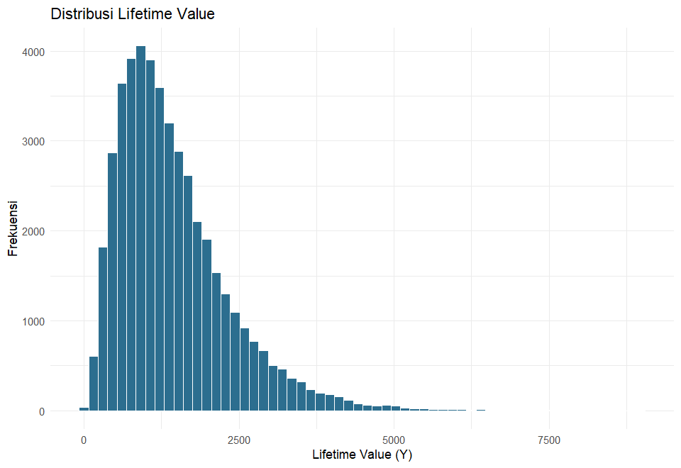
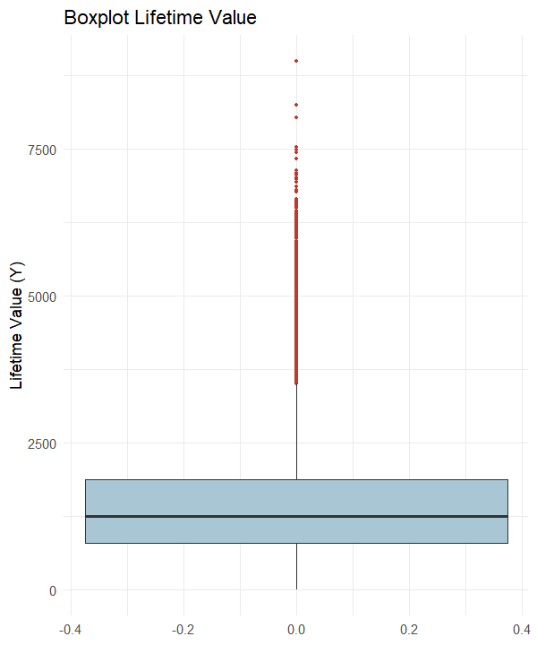
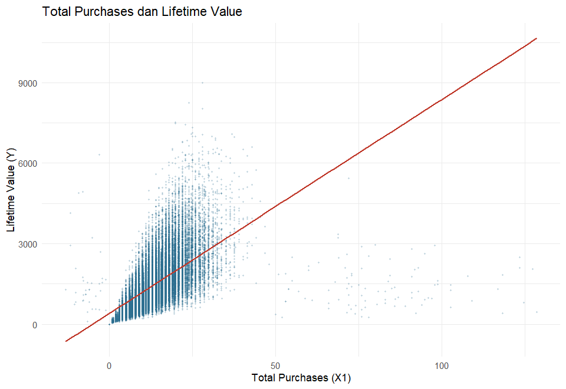
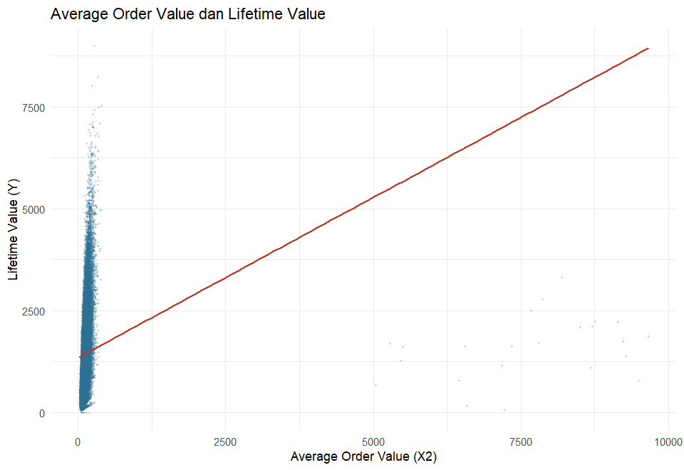
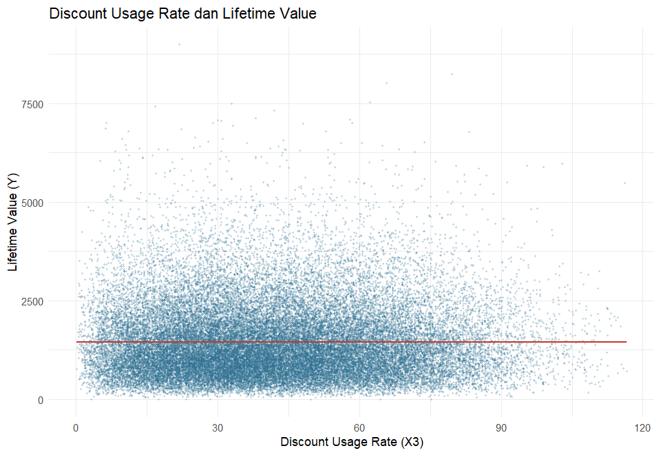
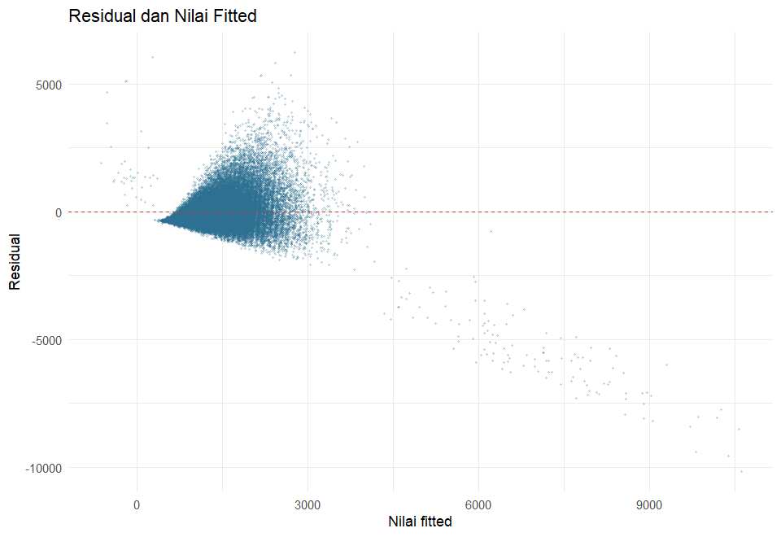
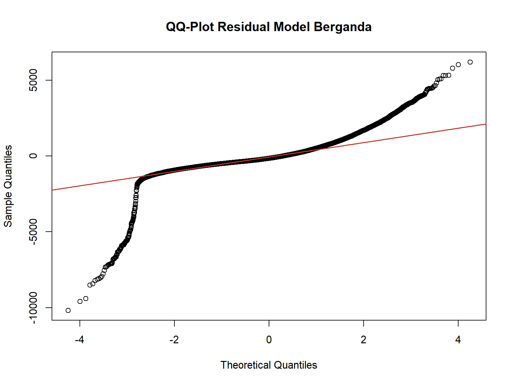

# Hasil - Analisis Perilaku Pelanggan E-Commerce

Halaman ini merangkum hasil pipeline `R/analysis.R`. Sumber datanya adalah
`dhairyajeetsingh/ecommerce-customer-behavior-dataset` dari Kaggle. Dataset ini
bersifat global dan bukan data transaksi produksi Indonesia. Pipeline membaca
50.000 baris awal dengan 25 kolom. Penyaringan `NA` pada empat variabel model
menyisakan 46.500 baris. Pemeriksaan duplikat setelah itu membuang 0 baris,
sehingga baris final tetap 46.500. Seluruh nilai memakai satuan dataset tanpa
simbol mata uang.

Variabel yang dianalisis:

- `Y` = `Lifetime_Value`, nilai lifetime value pelanggan
- `X1` = `Total_Purchases`, jumlah pembelian
- `X2` = `Average_Order_Value`, rata-rata nilai pesanan
- `X3` = `Discount_Usage_Rate`, tingkat penggunaan diskon

## 1. Ringkasan pipeline

| Tahap | Hasil |
|---|---|
| Sumber data | Kaggle `dhairyajeetsingh/ecommerce-customer-behavior-dataset`, 50.000 baris, 25 kolom |
| Pra-pengolahan | Konversi empat variabel model ke numerik, `complete.cases()`, lalu pembuangan duplikat dengan `!duplicated()` |
| Baris akhir | 46.500 baris, 3.500 dibuang karena `NA`, 0 duplikat dibuang, total 3.500 baris dibuang |
| Statistik deskriptif | Rataan, median, modus, varians, simpangan baku, minimum, kuartil, maksimum |
| Korelasi | Matriks Pearson untuk empat variabel model |
| Regresi | Model sederhana `Y ~ X1` dan model berganda `Y ~ X1 + X2 + X3` |
| Uji asumsi | VIF, Shapiro-Wilk pada 5.000 residual acak, Breusch-Pagan |
| Prediksi | Tiga skenario kuartil dengan interval kepercayaan 95 persen |
| Visualisasi | Tujuh plot tersimpan di `assets/` dan `output/plots/` |

## 2. EDA - 7 Visualisasi

### G1 - Distribusi `Lifetime_Value`

Rataan `Lifetime_Value` sebesar 1.441,20 dan median 1.244,79. Simpangan baku
906,14 lebih besar daripada median, dengan nilai maksimum 8.987,24. Histogram
menunjukkan ekor kanan yang panjang, sehingga rataan lebih tinggi daripada
median.

### G2 - Boxplot `Lifetime_Value`

Boxplot menegaskan konsentrasi nilai pada kisaran kuartil pertama sampai kuartil
ketiga, yaitu 790,59 sampai 1.875,76. Titik-titik di atas whisker membentuk ekor
kanan. Pemeriksaan ini menjadi dasar penggunaan median saat membaca sebaran.

### G3 - `Total_Purchases` terhadap `Lifetime_Value`

Korelasi Pearson `Y` dengan `X1` sebesar 0,620. Garis regresi pada scatter naik
teratur. Hubungan ini paling kuat di antara ketiga prediktor, tetapi penyebaran
titik tetap lebar pada jumlah pembelian tinggi.

### G4 - `Average_Order_Value` terhadap `Lifetime_Value`

Korelasi `Y` dengan `X2` sebesar 0,153. Arahnya positif, namun kekuatannya jauh
di bawah `X1`. Sebagian besar titik berada pada nilai pesanan di bawah 300,
sedangkan beberapa nilai ekstrem mencapai 9.666,38.

### G5 - `Discount_Usage_Rate` terhadap `Lifetime_Value`

Korelasi `Y` dengan `X3` hanya 0,001. Secara deskriptif, tingkat penggunaan
diskon tidak menunjukkan hubungan linier dengan `Lifetime_Value`. Koefisien
model berganda tetap bernilai negatif dan signifikan setelah `X1` dan `X2`
dikendalikan, sehingga interpretasinya harus dibaca sebagai asosiasi bersyarat,
bukan hubungan bivariat.

### G6 - Residual terhadap nilai fitted

Plot residual menunjukkan sebaran yang berubah pada nilai fitted tinggi. Uji
Breusch-Pagan mengonfirmasi heteroskedastisitas dengan `BP = 17058`, `df = 3`,
dan `p-value < 2,2e-16`.

### G7 - QQ plot residual

Titik-titik menyimpang dari garis diagonal, terutama pada ekor. Uji
Shapiro-Wilk atas 5.000 residual acak menghasilkan `W = 0,79227` dan
`p-value < 2,2e-16`, sehingga normalitas residual ditolak.

## 3. Statistik deskriptif

| Variabel | Rataan | Median | SD | Minimum | Q1 | Q3 | Maksimum |
|---|---:|---:|---:|---:|---:|---:|---:|
| `Lifetime_Value` | 1.441,20 | 1.244,79 | 906,14 | 0 | 790,59 | 1.875,76 | 8.987,24 |
| `Total_Purchases` | 13,13 | 12 | 7,05 | -13 | 8 | 17 | 128,7 |
| `Average_Order_Value` | 123,12 | 112,99 | 175,69 | 26,38 | 87,08 | 144,47 | 9.666,38 |
| `Discount_Usage_Rate` | 42,00 | 40,2 | 21,37 | 0,24 | 25,3 | 57 | 116,64 |

`Total_Purchases` memiliki nilai minimum negatif, yaitu -13. Nilai ini tetap
dipertahankan karena dua aturan pra-pengolahan hanya menyaring `NA` dan duplikat.
Tidak ada filter outlier atau kategori lain yang diterapkan.

## 4. Korelasi Pearson

| Pasangan | Korelasi |
|---|---:|
| `Lifetime_Value` dengan `Total_Purchases` | 0,620 |
| `Lifetime_Value` dengan `Average_Order_Value` | 0,153 |
| `Lifetime_Value` dengan `Discount_Usage_Rate` | 0,001 |
| `Total_Purchases` dengan `Average_Order_Value` | 0,005 |
| `Total_Purchases` dengan `Discount_Usage_Rate` | 0,038 |
| `Average_Order_Value` dengan `Discount_Usage_Rate` | 0,000 |

Korelasi antar prediktor sangat kecil. Hal ini sejalan dengan nilai VIF yang
berada di sekitar 1.

## 5. Regresi linear

| Model | Intercept | X1 | X2 | X3 | R² | R² tersesuaian |
|---|---:|---:|---:|---:|---:|---:|
| `Y ~ X1` | 394,764 | 79,725 | | | 0,3846 | 0,3846 |
| `Y ~ X1 + X2 + X3` | 339,451 | 79,746 | 0,772 | -0,953 | 0,4075 | 0,4075 |

Model sederhana menjelaskan 38,46 persen variasi `Lifetime_Value`. Penambahan
`X2` dan `X3` menaikkan R² menjadi 40,75 persen. Koefisien `X1` stabil di
kisaran 79,7. Koefisien `X3` bernilai -0,953 dengan `p-value = 3,19e-10`.
Statistik F model berganda sebesar 10.660 dengan `p-value < 2,2e-16`.

## 6. Uji asumsi

| Uji | Statistik | Kesimpulan |
|---|---|---|
| VIF `Total_Purchases` | 1,001436 | Tidak ada multikolinearitas berarti |
| VIF `Average_Order_Value` | 1,000021 | Tidak ada multikolinearitas berarti |
| VIF `Discount_Usage_Rate` | 1,001415 | Tidak ada multikolinearitas berarti |
| Shapiro-Wilk | `W = 0,79227`, `p < 2,2e-16` | Normalitas residual ditolak |
| Breusch-Pagan | `BP = 17058`, `df = 3`, `p < 2,2e-16` | Homoskedastisitas ditolak |

Pelanggaran dua asumsi tersebut dicatat sebagai keterbatasan. Standar error
konvensional dapat meleset, sehingga uji t, statistik F, dan interval
kepercayaan perlu dibaca dengan hati-hati.

## 7. Prediksi tiga skenario

| Skenario | `Total_Purchases` | `Average_Order_Value` | `Discount_Usage_Rate` | Prediksi | Batas bawah 95% | Batas atas 95% |
|---|---:|---:|---:|---:|---:|---:|
| Rendah | 8 | 87,08 | 25,3 | 1.020,54 | 1.011,27 | 1.029,81 |
| Menengah | 12 | 112,99 | 40,2 | 1.345,34 | 1.338,89 | 1.351,78 |
| Tinggi | 17 | 144,47 | 57 | 1.752,36 | 1.743,90 | 1.760,82 |

Nilai prediksi pada tiga kuartil prediktor ini bersifat deskriptif. Interval yang
ditampilkan adalah interval kepercayaan 95 persen untuk rataan, bukan interval
prediksi untuk satu pelanggan.

## 8. Keterbatasan

- Dataset global ini bukan data transaksi Indonesia dan tidak mewakili pasar
  tertentu.
- `Total_Purchases` memuat nilai negatif yang tetap dipertahankan sesuai aturan
  pra-pengolahan.
- Normalitas dan homoskedastisitas residual ditolak, sehingga inference
  konvensional perlu dibaca dengan hati-hati.
- Hubungan yang ditemukan bersifat asosiasi, bukan sebab akibat.
- Prediksi memakai tiga kombinasi kuartil dan tidak mencakup seluruh rentang
  nilai prediktor.

Rincian numerik tersedia di `output/tables/`, sedangkan log lengkap ada di
`output/analisis_log.txt`. Penjelasan metodologi dan cara menjalankan ulang
pipeline ada di [README.md](README.md).
