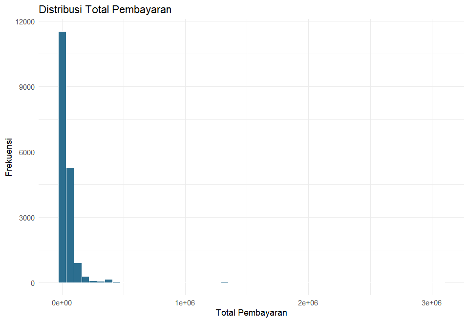
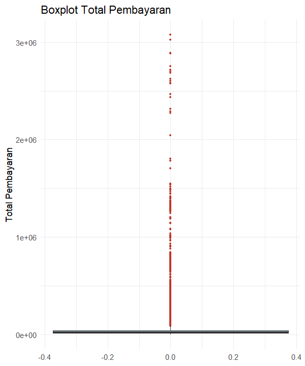
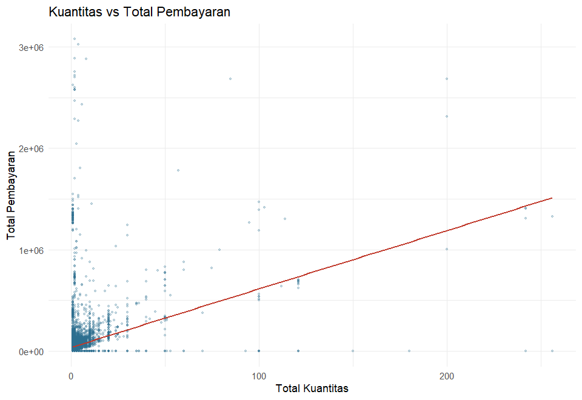
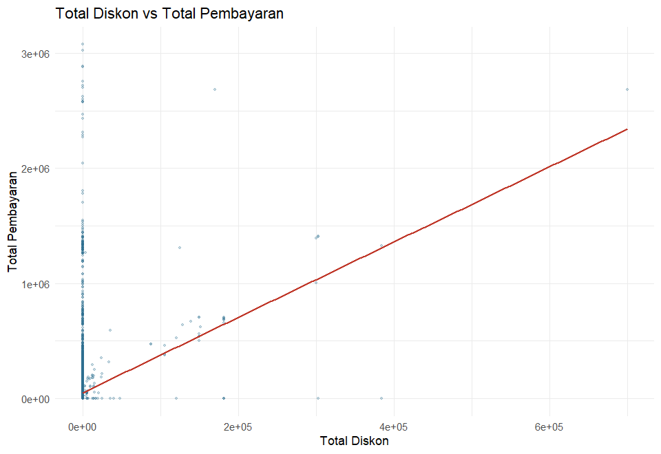
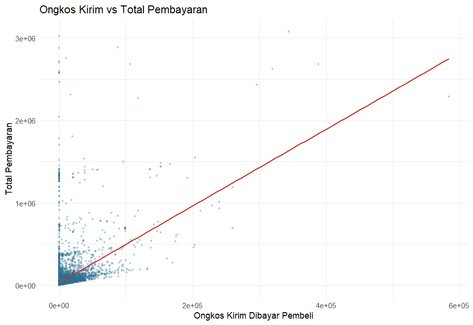
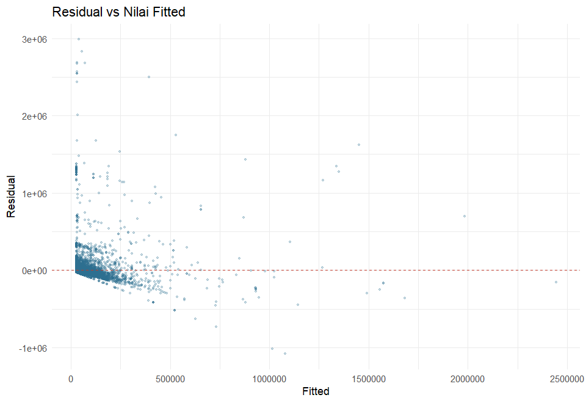
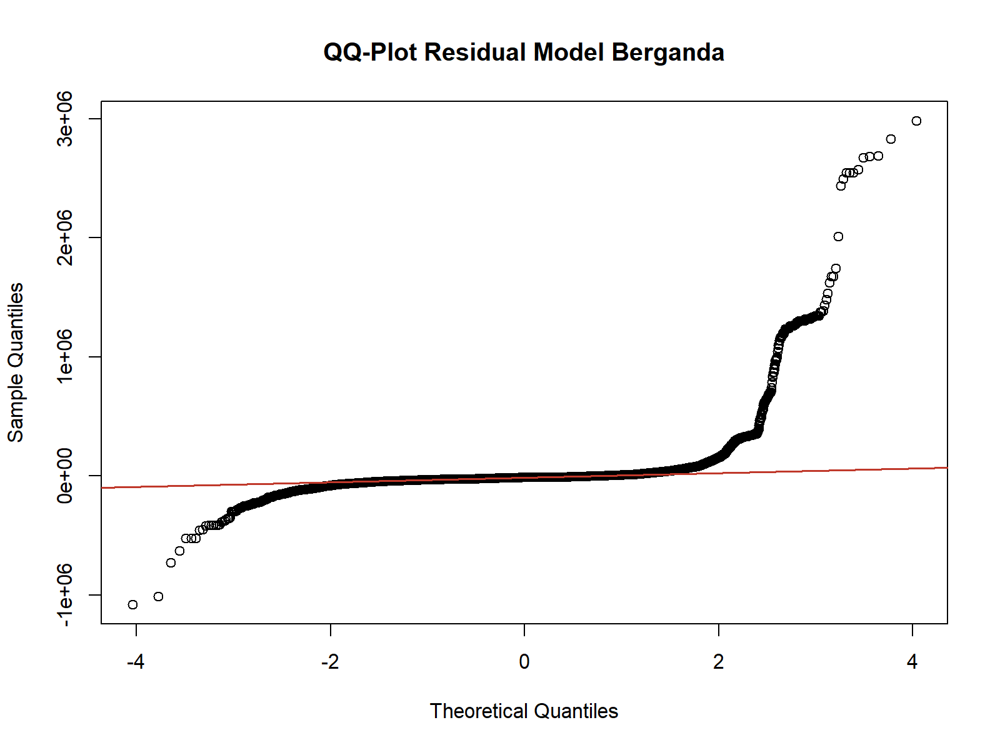

```{r setup, include=FALSE}
knitr::opts_chunk$set(echo = FALSE, warning = FALSE, message = FALSE, fig.align = "center")

desc <- read.csv("../output/tables/statistik_deskriptif.csv", stringsAsFactors = FALSE)
korelasi <- read.csv("../output/tables/korelasi.csv", check.names = FALSE, row.names = 1)
prediksi <- read.csv("../output/tables/prediksi.csv", stringsAsFactors = FALSE)
log_raw <- readLines("../output/analisis_log.txt", warn = FALSE)
prov_raw <- readLines("../output/tables/provenance.txt", warn = FALSE)
sederhana_raw <- readLines("../output/tables/regresi_sederhana.txt", warn = FALSE)
berganda_raw <- readLines("../output/tables/regresi_berganda.txt", warn = FALSE)
uji_raw <- readLines("../output/tables/uji_asumsi.txt", warn = FALSE)

ambil_baris <- function(pattern, teks) grep(pattern, teks, value = TRUE)[1]
ambil_bulat <- function(pattern, teks) {
  baris <- ambil_baris(pattern, teks)
  as.numeric(regmatches(baris, regexpr("[0-9]+", baris)))
}
ambil_desimal <- function(pattern, teks) {
  baris <- ambil_baris(pattern, teks)
  as.numeric(regmatches(baris, regexpr("[0-9]+[.][0-9]+", baris)))
}
fmt <- function(x, digits = 0) {
  formatC(x, format = "f", digits = digits, big.mark = ".", decimal.mark = ",")
}
rp <- function(x, digits = 0) paste0("Rp", fmt(x, digits))

baris_awal <- ambil_bulat("^Baris awal:", log_raw)
kolom_awal <- ambil_bulat("^Kolom awal:", log_raw)
baris_duplikat <- ambil_bulat("^Baris duplikat:", log_raw)
na_dibuang <- ambil_bulat("^Baris dibuang karena NA pada variabel model:", log_raw)
baris_final <- ambil_bulat("^Jumlah baris final:", log_raw)
n_shapiro <- ambil_bulat("^Ukuran sampel:", log_raw)

url_sumber <- sub("^URL resmi +: +", "", ambil_baris("^URL resmi", prov_raw))
lisensi <- sub("^Lisensi +: +", "", ambil_baris("^Lisensi", prov_raw))
tanggal_verifikasi <- sub("^Tanggal verifikasi +: +", "", ambil_baris("^Tanggal verifikasi", prov_raw))

stat <- function(v) desc[desc$variabel == v, ]
y <- stat("total_pembayaran")
x1 <- stat("total_qty")
x2 <- stat("total_diskon")
x3 <- stat("ongkos_kirim_dibayar_oleh_pembeli")

k <- function(a, b) korelasi[a, b]

parse_koef <- function(file, model) {
  raw <- readLines(file, warn = FALSE)
  pola <- "[(]Intercept[)]|^[[:space:]]*total_qty|^[[:space:]]*total_diskon|^[[:space:]]*ongkos_kirim"
  baris <- grep(pola, raw, value = TRUE)
  out <- do.call(rbind, lapply(baris, function(s) {
    p <- strsplit(trimws(s), "[[:space:]]+")[[1]]
    data.frame(
      model = model,
      prediktor = p[1],
      estimasi = as.numeric(p[2]),
      galat_baku = as.numeric(p[3]),
      t = as.numeric(p[4]),
      p = p[5],
      stringsAsFactors = FALSE
    )
  }))
  out
}
koef <- rbind(parse_koef("../output/tables/regresi_sederhana.txt", "Sederhana"),
              parse_koef("../output/tables/regresi_berganda.txt", "Berganda"))
label_pred <- c(
  "(Intercept)" = "Intercept",
  "total_qty" = "X1: total_qty",
  "total_diskon" = "X2: total_diskon",
  "ongkos_kirim_dibayar_oleh_pembeli" = "X3: ongkos kirim"
)
koef$prediktor <- unname(label_pred[koef$prediktor])

r2_sederhana <- ambil_desimal("Multiple R-squared", sederhana_raw)
adj_r2_sederhana <- ambil_desimal("Adjusted R-squared", sub(".*Multiple R-squared: +[0-9.]+,[[:space:]]+", "", sederhana_raw))
r2_berganda <- ambil_desimal("Multiple R-squared", berganda_raw)
adj_r2_berganda <- ambil_desimal("Adjusted R-squared", sub(".*Multiple R-squared: +[0-9.]+,[[:space:]]+", "", berganda_raw))
f_berganda <- ambil_bulat("F-statistic", berganda_raw)

beta_x1_sederhana <- koef$estimasi[koef$model == "Sederhana" & koef$prediktor == "X1: total_qty"]
beta_intercept_sederhana <- koef$estimasi[koef$model == "Sederhana" & koef$prediktor == "Intercept"]
beta_x1 <- koef$estimasi[koef$model == "Berganda" & koef$prediktor == "X1: total_qty"]
beta_x2 <- koef$estimasi[koef$model == "Berganda" & koef$prediktor == "X2: total_diskon"]
beta_x3 <- koef$estimasi[koef$model == "Berganda" & koef$prediktor == "X3: ongkos kirim"]
beta_intercept <- koef$estimasi[koef$model == "Berganda" & koef$prediktor == "Intercept"]
p_x2 <- koef$p[koef$model == "Berganda" & koef$prediktor == "X2: total_diskon"]

blok_vif <- uji_raw[(grep("Multikolinearitas", uji_raw) + 1):(grep("Normalitas residual", uji_raw) - 1)]
teks_vif <- paste(blok_vif, collapse = " ")
vif <- as.numeric(unlist(regmatches(teks_vif, gregexpr("[0-9]+[.][0-9]+", teks_vif))))
baris_shapiro <- ambil_baris("^W = ", uji_raw)
w_shapiro <- ambil_desimal("^W = ", uji_raw)
p_shapiro <- regmatches(baris_shapiro, regexpr("< [0-9]+[.][0-9]+e[-][0-9]+", baris_shapiro))
baris_bp <- ambil_baris("^BP = ", uji_raw)
bp <- ambil_desimal("^BP = ", uji_raw)
df_bp <- as.numeric(regmatches(sub(".*df = ", "", baris_bp), regexpr("[0-9]+", sub(".*df = ", "", baris_bp))))
p_bp <- regmatches(baris_bp, regexpr("< [0-9]+[.][0-9]+e[-][0-9]+", baris_bp))

label_var <- c(
  total_pembayaran = "Y: pembayaran",
  total_qty = "X1: kuantitas",
  total_diskon = "X2: diskon",
  ongkos_kirim_dibayar_oleh_pembeli = "X3: ongkos kirim"
)
desc_tampil <- data.frame(
  Variabel = unname(label_var[desc$variabel]),
  Rataan = fmt(desc$mean, 2),
  Median = fmt(desc$median, 2),
  SD = fmt(desc$sd, 2),
  Minimum = fmt(desc$min, 0),
  Q1 = fmt(desc$q1, 0),
  Q3 = fmt(desc$q3, 0),
  Maksimum = fmt(desc$max, 0),
  check.names = FALSE
)

korelasi_tampil <- data.frame(
  Variabel = unname(label_var[rownames(korelasi)]),
  Y = fmt(korelasi$total_pembayaran, 3),
  X1 = fmt(korelasi$total_qty, 3),
  X2 = fmt(korelasi$total_diskon, 3),
  X3 = fmt(korelasi$ongkos_kirim_dibayar_oleh_pembeli, 3),
  check.names = FALSE
)

koef_tampil <- data.frame(
  Model = koef$model,
  Prediktor = koef$prediktor,
  Estimasi = fmt(koef$estimasi, 3),
  `Galat baku` = fmt(koef$galat_baku, 3),
  t = fmt(koef$t, 3),
  p = koef$p,
  check.names = FALSE
)

vif_tampil <- data.frame(
  Prediktor = c("X1: total_qty", "X2: total_diskon", "X3: ongkos kirim"),
  VIF = fmt(vif, 3),
  check.names = FALSE
)

prediksi_tampil <- data.frame(
  Skenario = prediksi$skenario,
  X1 = fmt(prediksi$total_qty, 0),
  X2 = fmt(prediksi$total_diskon, 0),
  X3 = fmt(prediksi$ongkos_kirim_dibayar_oleh_pembeli, 0),
  Prediksi = rp(prediksi$prediksi, 2),
  `Interval kepercayaan 95%` = paste0("[", rp(prediksi$batas_bawah_95, 2), "; ", rp(prediksi$batas_atas_95, 2), "]"),
  check.names = FALSE
)
```

# Bab 1 Pendahuluan

Transaksi e-commerce menyisakan catatan tentang jumlah barang, nilai diskon, dan ongkos kirim yang dibayar pembeli. Ketiga besaran itu tersedia di dataset Indonesia E-Commerce Sales bersama nilai total pembayaran. Analisis ini memakai regresi linear untuk mengukur seberapa besar hubungan antara ketiga prediktor tersebut dan total pembayaran. Fokusnya adalah pola asosiasi pada data transaksi yang sudah dibersihkan, bukan mekanisme penentuan harga di dalam sistem toko.

Rumusan masalahnya dirumuskan sebagai dua pertanyaan. Pertama, bagaimana total kuantitas, total diskon, dan ongkos kirim yang dibayar pembeli menjelaskan variasi total pembayaran. Kedua, apakah hubungan yang diperoleh cukup kuat untuk menghasilkan prediksi yang berguna pada kombinasi nilai yang sejenis dengan data. Tujuan analisis mengikuti pertanyaan itu, yaitu mendeskripsikan keempat variabel, mengukur korelasi antarvariabel, membangun model regresi sederhana dan berganda, menilai asumsi model, lalu memprediksi total pembayaran pada tiga skenario.

# Bab 2 Sumber Data dan Preprocessing

Data diperoleh dari dataset Indonesia E-Commerce Sales yang dipublikasikan oleh ZkyFauzi di Kaggle, `r url_sumber`, dengan lisensi `r lisensi`. Berkas mentahnya bernama `indonesia_ecommerce_sales_challenging.csv` dan disalin ke dalam proyek sebagai `data/raw/ec_indonesia.csv`. Provenansi diverifikasi pada `r tanggal_verifikasi` melalui endpoint metadata Kaggle. Dataset awal memuat `r fmt(baris_awal)` baris data dan `r fmt(kolom_awal)` kolom.

Pembacaan berkas memakai `read.csv2` dengan delimiter titik koma dan encoding UTF-8. Nama kolom yang memakai spasi diubah menjadi bentuk snake_case, lalu keempat variabel model dinyatakan sebagai `Y = total_pembayaran`, `X1 = total_qty`, `X2 = total_diskon`, dan `X3 = ongkos_kirim_dibayar_oleh_pembeli`. Kolom-kolom ini dikonversi ke tipe numerik sebelum dianalisis.


Pemeriksaan duplikat menemukan `r fmt(baris_duplikat)` baris ganda, sehingga tidak ada baris yang dibuang pada langkah tersebut. Penghapusan dilakukan karena `r fmt(na_dibuang)` observasi memiliki nilai kosong pada minimal satu variabel model; pada log analisis, `total_qty` menjadi kolom model yang menyumbang nilai kosong itu. Penyaringan memakai `complete.cases` pada keempat variabel model, diikuti pengurutan berdasarkan `order_id`. Jumlah baris yang dipakai dalam seluruh analisis adalah `r fmt(baris_final)`.

# Bab 3 Statistika Deskriptif

Tabel 3.1 merangkum statistik deskriptif dari `statistik_deskriptif.csv`. Nilai pada tabel dibulatkan untuk keperluan tampilan, sedangkan perhitungan memakai nilai asli pada berkas keluaran.

```{r}
knitr::kable(desc_tampil, caption = "Tabel 3.1 Statistik deskriptif variabel model", align = c("l", "r", "r", "r", "r", "r", "r", "r"))
```

Total pembayaran memiliki rata-rata `r rp(y$mean, 2)` dan median `r rp(y$median, 2)`. Simpangan bakunya `r rp(y$sd, 2)` jauh lebih besar daripada rata-rata, sementara nilai maksimum `r rp(y$max)` berada di atas kuartil ketiga `r rp(y$q3)`. Modusnya `r rp(y$modus)`, sehingga nilai itu menjadi nilai yang paling sering muncul. Histogram pada Gambar 3.1 dan boxplot pada Gambar 3.2 memperlihatkan pemusatan nilai pada rentang bawah disertai ekor kanan yang panjang.

```{r, fig.cap="Gambar 3.1 Distribusi total pembayaran", out.width="75%"}

```

```{r, fig.cap="Gambar 3.2 Boxplot total pembayaran", out.width="45%"}

```

Kuantitas barang rata-rata `r fmt(x1$mean, 2)` unit dengan median `r fmt(x1$median, 0)` unit, kuartil ketiga `r fmt(x1$q3, 0)` unit, dan nilai maksimum `r fmt(x1$max, 0)` unit. Total diskon memiliki rata-rata `r rp(x2$mean, 2)` tetapi median dan kuartil ketiganya `r rp(x2$median)`, sehingga sebagian besar transaksi tidak mencatat diskon. Ongkos kirim yang dibayar pembeli memiliki rata-rata `r rp(x3$mean, 2)`, median `r rp(x3$median)`, dan kuartil ketiga `r rp(x3$q3)`. Pola ini menjelaskan mengapa titik pada scatter plot diskon dan ongkos kirim banyak bertumpu di nilai nol.

# Bab 4 Analisis Korelasi

Matriks korelasi Pearson pada Tabel 4.1 dihitung dari `korelasi.csv`. Seluruh pasangan bertanda positif, tetapi kekuatannya tidak sama.

```{r}
knitr::kable(korelasi_tampil, caption = "Tabel 4.1 Matriks korelasi Pearson", align = c("l", "r", "r", "r", "r"))
```

Ongkos kirim yang dibayar pembeli memiliki korelasi tertinggi dengan total pembayaran, yaitu `r fmt(k("total_pembayaran", "ongkos_kirim_dibayar_oleh_pembeli"), 3)`. Kuantitas barang menyusul dengan `r fmt(k("total_pembayaran", "total_qty"), 3)`, sedangkan total diskon berada pada `r fmt(k("total_pembayaran", "total_diskon"), 3)`. Hubungan total kuantitas dan total diskon mencapai `r round(k("total_qty", "total_diskon"), 3)`, angka yang jauh lebih besar daripada korelasi masing-masing prediktor dengan pembayaran. Hal itu menjadi alasan untuk memeriksa multikolinearitas setelah model berganda dibangun.

Gambar 4.1, Gambar 4.2, dan Gambar 4.3 menyajikan hubungan pasangan prediktor terhadap total pembayaran. Arah garis pada ketiga scatter plot mengikuti tanda korelasi. Sebaran titik berbeda-beda karena kuantitas memuat nilai ekstrem, diskon bertumpu di nol, dan ongkos kirim memiliki nilai nol pada banyak transaksi.

```{r, fig.cap="Gambar 4.1 Kuantitas barang terhadap total pembayaran", out.width="75%"}

```

```{r, fig.cap="Gambar 4.2 Total diskon terhadap total pembayaran", out.width="75%"}

```

```{r, fig.cap="Gambar 4.3 Ongkos kirim terhadap total pembayaran", out.width="75%"}

```

# Bab 5 Analisis Regresi

Model sederhana hanya memakai total kuantitas. Persamaannya: total pembayaran prediksi = `r rp(beta_intercept_sederhana, 1)` + `r fmt(beta_x1_sederhana, 1)` X1. Nilai `r rp(beta_x1_sederhana, 1)` berarti setiap tambah satu unit kuantitas dihubungkan dengan kenaikan total pembayaran sebesar `r rp(beta_x1_sederhana, 1)`, dengan asumsi prediktor lain tidak masuk model. Nilai R squared model ini `r fmt(r2_sederhana, 5)`, artinya sekitar `r fmt(r2_sederhana * 100, 2)` persen variasi total pembayaran dapat dijelaskan oleh kuantitas. Intercept `r rp(beta_intercept_sederhana, 1)` perlu dibaca sebagai konstanta matematis karena nilai kuantitas minimum pada data adalah `r fmt(x1$min, 0)` unit.

Model berganda menambahkan total diskon dan ongkos kirim. Persamaannya: total pembayaran prediksi = `r rp(beta_intercept, 0)` + `r fmt(beta_x1, 0)` X1 + `r fmt(beta_x2, 3)` X2 + `r fmt(beta_x3, 3)` X3. Nilai R squared naik menjadi `r fmt(r2_berganda, 4)` dan R squared tersesuaikan `r fmt(adj_r2_berganda, 4)`; statistik F bernilai `r fmt(f_berganda, 0)`. Tabel 5.1 menyajikan seluruh koefisien dari kedua model.

```{r}
knitr::kable(koef_tampil, caption = "Tabel 5.1 Koefisien model regresi", align = c("l", "l", "r", "r", "r", "l"))
```

Koefisien X1 pada model berganda sebesar `r rp(beta_x1, 0)` per unit kuantitas, lebih kecil daripada `r rp(beta_x1_sederhana, 1)` pada model sederhana. Penurunan ini berkaitan dengan korelasi X1 dan X2 sebesar `r fmt(k("total_qty", "total_diskon"), 3)` yang telah dibahas sebelumnya. Koefisien X2 sebesar `r rp(beta_x2, 3)` per rupiah diskon tidak signifikan, dengan `r paste0("p = ", p_x2)`; dengan demikian tidak ada bukti statistik bahwa diskon berhubungan dengan pembayaran setelah X1 dan X3 dikendalikan. Koefisien X3 sebesar `r rp(beta_x3, 3)` per rupiah ongkos kirim yang dibayar pembeli, dengan arah positif dan signifikan. Intercept model berganda `r rp(beta_intercept, 0)` menunjukkan nilai prediksi ketika ketiga prediktor bernilai nol.

# Bab 6 Evaluasi Model

Tabel 6.1 memuat hasil multikolinearitas dari `uji_asumsi.txt`. Nilai VIF untuk X1, X2, dan X3 berturut-turut adalah `r fmt(vif[1], 3)`, `r fmt(vif[2], 3)`, dan `r fmt(vif[3], 3)`. Ketiganya tidak menunjukkan tumpang tindih yang ekstrem, walaupun korelasi X1 dan X2 sebelumnya tergolong tinggi.

```{r}
knitr::kable(vif_tampil, caption = "Tabel 6.1 Nilai variance inflation factor", align = c("l", "r"))
```

Uji Shapiro-Wilk dijalankan pada sampel acak `r fmt(n_shapiro)` residual. Statistik W bernilai `r fmt(w_shapiro, 5)` dengan p-value `r p_shapiro`, sehingga normalitas residual ditolak. Penyimpangan itu tampak pula pada QQ plot di Gambar 6.2, khususnya pada kedua ekor distribusi.

Uji Breusch-Pagan menghasilkan BP sebesar `r fmt(bp, 2)` dengan df `r fmt(df_bp, 0)` dan p-value `r p_bp`. Homoskedastisitas juga ditolak. Plot residual terhadap nilai fitted pada Gambar 6.1 memperlihatkan sebaran yang tidak merata saat nilai fitted meningkat, sesuai dengan hasil uji tersebut.

```{r, fig.cap="Gambar 6.1 Residual terhadap nilai fitted", out.width="75%"}

```

```{r, fig.cap="Gambar 6.2 QQ plot residual model berganda", out.width="70%"}

```

Kedua pelanggaran asumsi perlu dinyatakan dengan terus terang. Standar error konvensional dapat bias, sehingga uji t, statistik F, dan interval kepercayaan tidak dapat dibaca dengan keyakinan penuh. Koefisien yang diestimasi tetap menggambarkan asosiasi dalam sampel, tetapi interpretasinya dibatasi pada pola data yang diamati. Analisis ini tidak menjalankan robust standard error, transformasi variabel, atau bootstrap, sehingga laporan ini tidak mengklaim perbaikan terhadap masalah tersebut.

# Bab 7 Prediksi

Tabel 7.1 memuat prediksi dari `prediksi.csv`. Interval yang ditampilkan adalah interval kepercayaan 95 persen untuk nilai rata-rata total pembayaran, bukan interval prediksi untuk satu transaksi individu.

```{r}
knitr::kable(prediksi_tampil, caption = "Tabel 7.1 Prediksi total pembayaran pada tiga skenario", align = c("l", "r", "r", "r", "r", "l"))
```

Skenario 1 memakai satu unit kuantitas tanpa diskon dan tanpa ongkos kirim, dengan prediksi `r rp(prediksi$prediksi[1], 2)`. Skenario 2 menambah ongkos kirim sebesar `r rp(prediksi$ongkos_kirim_dibayar_oleh_pembeli[2], 0)` dan menghasilkan prediksi `r rp(prediksi$prediksi[2], 2)`. Selisih keduanya mendekati `r rp(beta_x3 * prediksi$ongkos_kirim_dibayar_oleh_pembeli[2], 0)`, sesuai dengan koefisien X3. Skenario 3 menaikkan kuantitas menjadi `r fmt(prediksi$total_qty[3], 0)` unit dengan prediksi `r rp(prediksi$prediksi[3], 2)`; kenaikan dari skenario 1 mendekati koefisien X1 sebesar `r rp(beta_x1, 0)`.

Nilai-nilai ini tetap bersifat deskriptif. Interval kepercayaan dihitung dari model yang asumsi normalitas dan homoskedastisitasnya ditolak, sehingga lebar interval perlu dibaca dengan hati-hati. Prediksi juga hanya relevan untuk kombinasi prediktor yang masih berada di sekitar pola data yang digunakan.

# Bab 8 Kesimpulan

Analisis menjawab tujuan yang dirumuskan pada Bab 1. Total kuantitas dan ongkos kirim yang dibayar pembeli memiliki hubungan positif dan signifikan dengan total pembayaran, sedangkan total diskon tidak signifikan dengan `r paste0("p = ", p_x2)`. Model berganda menjelaskan `r fmt(r2_berganda * 100, 2)` persen variasi total pembayaran, naik dari `r fmt(r2_sederhana * 100, 2)` persen pada model sederhana. Prediksi untuk tiga skenario tersedia pada Tabel 7.1, dengan batas interval yang bergantung pada model yang sama.

Keterbatasan analisis perlu disebut secara tegas. Data ini berupa catatan transaksi, bukan hasil eksperimen, sehingga hubungan yang ditemukan tidak dapat diartikan sebagai sebab akibat. Variabel diskon tidak memberi bukti signifikan, dan pelanggaran normalitas serta homoskedastisitas melemahkan kepercayaan terhadap standar error dan interval. Selain itu, banyaknya nilai nol dan keberadaan pembayaran ekstrem membuat model linear hanya menangkap sebagian kecil variasi. Kesimpulan dengan demikian dibatasi pada asosiasi dalam dataset ini.

# Lampiran

Daftar berkas keluaran yang dipakai dalam laporan ini:

- `output/analisis_log.txt` berisi log proses cleaning dan seluruh tahap analisis.
- `output/tables/provenance.txt`, `statistik_deskriptif.csv`, `korelasi.csv`, `regresi_sederhana.txt`, `regresi_berganda.txt`, `uji_asumsi.txt`, dan `prediksi.csv` berisi tabel serta ringkasan numerik.
- `output/plots/hist_y.png`, `box_y.png`, `scatter_qty_y.png`, `scatter_diskon_y.png`, `scatter_ongkir_y.png`, `residual_vs_fitted.png`, dan `qq_plot.png` berisi visualisasi.
- `laporan/laporan.Rmd`, `laporan/laporan.pdf`, dan `laporan/render_log.txt` berisi sumber laporan, hasil render, dan catatan render.

Sumber data: [Indonesia E-Commerce Sales di Kaggle](`r url_sumber`), dengan lisensi `r lisensi`.
