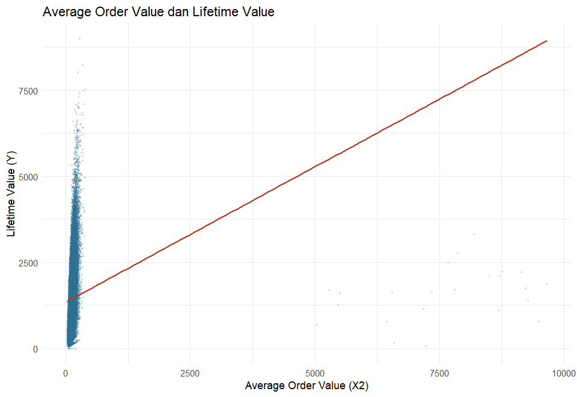
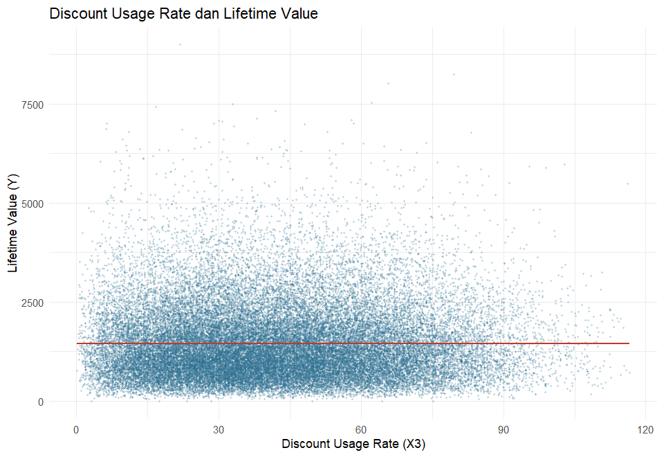

# Presentasi: Analisis regresi Lifetime_Value pada data e-commerce global

Setiap slide memuat isi layar dan catatan demo. Path gambar dihitung relatif dari berkas `presentasi/slide.md`.

---

## Slide 1: Judul

**Isi slide**

- Analisis regresi `Lifetime_Value` pada data perilaku pelanggan e-commerce global.
- Tugas Statistik, bidang Ekonomi dan Bisnis.
- Sumber data: Kaggle, ecommerce customer behavior dataset.
- Fokus: hubungan `Lifetime_Value` dengan `Total_Purchases`, `Average_Order_Value`, dan `Discount_Usage_Rate`.

**Catatan demo**

- Awali dengan unit analisis, yaitu pelanggan dalam dataset, bukan transaksi produksi.
- Sebut bahwa seluruh angka pada slide berasal dari berkas hasil `R/analysis.R`.

---

## Slide 2: Tujuan proyek dan topik

**Isi slide**

- Bidang: Ekonomi dan Bisnis, dengan fokus pada nilai lifetime pelanggan.
- Pertanyaan utama: variabel apa yang berkaitan dengan `Lifetime_Value`?
- Tujuan: mengukur hubungan `Lifetime_Value` dengan jumlah pembelian, rata-rata nilai pesanan, dan tingkat penggunaan diskon.
- Hasil akhir: perbandingan model regresi sederhana dan berganda, lalu tiga skenario prediksi di `output/tables/prediksi.csv`.

**Catatan demo**

- Tekankan bahwa analisis bersifat asosiatif, bukan sebab akibat.
- Sebut keempat variabel model sebelum masuk ke angka.

---

## Slide 3: Sumber data

**Isi slide**

- Dataset: ecommerce customer behavior dataset, Kaggle `dhairyajeetsingh/ecommerce-customer-behavior-dataset`.
- URL dataset: https://www.kaggle.com/datasets/dhairyajeetsingh/ecommerce-customer-behavior-dataset
- Ukuran awal: 50.000 baris dan 25 kolom.
- Status data: dataset global, bukan data Indonesia, dan bukan data transaksi produksi yang terverifikasi.

**Catatan demo**

- Tunjukkan URL dataset lalu sebut bahwa berkas mentah tidak disertakan di repo karena ukurannya.
- Jika ditanya soal wilayah, jawab terus terang bahwa dataset ini tidak dikhususkan untuk Indonesia.

---

## Slide 4: Preprocessing

**Isi slide**

- Dataset CSV dibaca lalu empat variabel model dikonversi ke numerik.
- Baris dengan NA pada `Lifetime_Value`, `Total_Purchases`, `Average_Order_Value`, atau `Discount_Usage_Rate` dibuang, menyisakan 46.500 baris.
- Baris duplikat dari hasil penyaringan dibuang dengan `!duplicated()`; 0 baris duplikat ditemukan.
- Baris awal 50.000, 3.500 dibuang karena NA, 0 duplikat, baris final 46.500, total dibuang 3.500.

**Catatan demo**

- Buka `output/analisis_log.txt` dan arahkan ke bagian jumlah baris awal, jumlah baris dibuang, dan jumlah baris final.
- Jelaskan bahwa aturan ini dipakai sebelum statistik deskriptif, korelasi, dan regresi dihitung.

---

## Slide 5: Variabel model

**Isi slide**

| Peran | Variabel | Keterangan |
|---|---|---|
| Y | `Lifetime_Value` | Variabel respons, unit nilai dataset |
| X1 | `Total_Purchases` | Jumlah pembelian |
| X2 | `Average_Order_Value` | Rata-rata nilai pesanan |
| X3 | `Discount_Usage_Rate` | Tingkat penggunaan diskon |

- Satu unit angka mengikuti satuan dataset, bukan rupiah.
- Pemetaan Y, X1, X2, dan X3 dipakai konsisten pada seluruh slide dan grafik.

**Catatan demo**

- Sebut pemetaan sekali di awal supaya pembaca tidak perlu menekan legenda grafik.
- Tunjukkan bahwa model tidak memakai kolom lain dari 25 kolom yang tersedia.

---

## Slide 6: Statistik deskriptif

**Isi slide**

- Statistik deskriptif dihitung untuk Y, X1, X2, dan X3 pada sampel final n = 46.500.
- Ringkasan mencakup mean, median, modus, varians, sd, minimum, Q1, Q2, Q3, dan maksimum.
- Tabel lengkap tersaji di `output/tables/statistik_deskriptif.csv`.
- Histogram dan boxplot `Lifetime_Value` dipakai untuk membaca bentuk distribusi dan titik ekstrem.

**Catatan demo**

- Tunjukkan histogram terlebih dahulu, lalu boxplot.
- Rujuk `statistik_deskriptif.csv` bila dosen meminta nilai mean, median, atau kuartil.

---

## Slide 7: Korelasi Pearson

**Isi slide**

| Pasangan | Koefisien korelasi |
|---|---:|
| Y dengan X1 | 0,620 |
| Y dengan X2 | 0,153 |
| Y dengan X3 | 0,001 |
| X1 dengan X2 | 0,005 |

- X1 memiliki hubungan linear terkuat dengan Y.
- X2 dan X3 hanya memiliki hubungan linear yang sangat lemah dengan Y.
- X1 dan X2 hampir tidak berkorelasi, sehingga tidak ada indikasi kuat multikolinearitas antara keduanya.

**Catatan demo**

- Tunjukkan tiga scatter plot secara berurutan sesuai urutan tabel korelasi.
- Tekankan bahwa korelasi tidak diperluas menjadi klaim sebab akibat.

---

## Slide 8: Regresi linear sederhana

**Isi slide**

- Model: Y = 394,764 + 79,725 X1.
- Slope X1 = 79,725; intercept = 394,764.
- R² = 0,3846, sehingga model menjelaskan sekitar 38,46% variasi `Lifetime_Value`.
- Setiap tambahan satu unit `Total_Purchases` berhubungan dengan tambahan 79,725 unit nilai dataset pada `Lifetime_Value`.

**Catatan demo**

- Tunjukkan `output/tables/regresi_sederhana.txt`.
- Kembali ke `scatter_purchases_y.png` saat menjelaskan slope dan sebaran titik.

---

## Slide 9: Regresi linear berganda

**Isi slide**

- Model: Y = 339,451 + 79,746 X1 + 0,772 X2 - 0,953 X3.
- R² = 0,4075; R² adjusted sekitar 0,4075.
- Model berganda signifikan secara keseluruhan.
- X1 tetap menjadi prediktor utama dengan koefisien 79,746.
- X2 berkoefisien 0,772 dan X3 berkoefisien -0,953, keduanya jauh lebih kecil daripada X1.
- Penambahan X2 dan X3 menaikkan R² dari 0,3846 menjadi 0,4075.

**Catatan demo**

- Tunjukkan `output/tables/regresi_berganda.txt`, khususnya kolom `Estimate` dan `Pr(>|t|)`.
- Kaitkan kenaikan R² dengan korelasi X1-X2 sebesar 0,005 pada slide 7.

---

## Slide 10: Evaluasi asumsi dan prediksi

**Isi slide**

- Evaluasi asumsi memakai VIF untuk multikolinearitas, Shapiro-Wilk untuk normalitas residual, dan Breusch-Pagan untuk heteroskedastisitas.
- Nilai lengkap ketiga uji dibaca dari `output/tables/uji_asumsi.txt`.
- Prediksi dihitung dari model berganda dengan interval keyakinan 95%.

| Skenario | X1 | X2 | X3 | Prediksi Y |
|---|---:|---:|---:|---:|
| Rendah | 8 | 87,08 | 25,3 | 1.020,54 |
| Menengah | 12 | 112,99 | 40,2 | 1.345,34 |
| Tinggi | 17 | 144,47 | 57 | 1.752,36 |

- Batas bawah dan batas atas 95% untuk ketiga skenario tersaji di `output/tables/prediksi.csv`.

**Catatan demo**

- Tunjukkan `output/tables/uji_asumsi.txt` sebelum `output/tables/prediksi.csv`.
- Jelaskan bahwa angka prediksi merupakan ilustrasi model, bukan jaminan nilai pelanggan tertentu.

---

## Slide 11: Demo RStudio

**Isi slide**

- Pastikan working directory berada di root proyek `projek_uas` agar path relatif terbaca.
- Buka `R/analysis.R` di RStudio, lalu jalankan seluruh skrip dengan `Source` atau `Ctrl+Shift+Enter`.
- Tunjukkan `output/analisis_log.txt` untuk alur lengkap: 50.000 baris awal, 46.500 baris final, R², uji asumsi, dan prediksi.
- Tunjukkan `output/tables/statistik_deskriptif.csv`, `korelasi.csv`, `regresi_sederhana.txt`, `regresi_berganda.txt`, `uji_asumsi.txt`, dan `prediksi.csv`.
- Tunjukkan `output/plots/hist_y.png`, `box_y.png`, `scatter_purchases_y.png`, `scatter_order_value_y.png`, `scatter_discount_y.png`, `residual_vs_fitted.png`, dan `qq_plot.png`.

**Catatan demo**

- Jalankan skrip sekali di depan kelas, lalu memakai hasil tersimpan untuk mempercepat sesi tanya jawab.
- Jika R melaporkan paket belum tersedia, pasang paket yang diminta oleh pesan galat sebelum menjalankan ulang skrip.

---

## Slide 12: Tanya jawab

**Isi slide**

- **Mengapa X1 menjadi prediktor utama?** Korelasi Y-X1 sebesar 0,620 dan koefisien X1 sebesar 79,746, jauh di atas koefisien X2 dan X3.
- **Apakah X2 dan X3 penting?** Korelasi keduanya dengan Y hanya 0,153 dan 0,001. Koefisien X2 sebesar 0,772 dan X3 sebesar -0,953 menaikkan R² dari 0,3846 menjadi 0,4075.
- **Apakah model berganda layak?** Model signifikan secara keseluruhan dengan R² = 0,4075, sehingga sekitar 59,25% variasi `Lifetime_Value` masih berada di luar model.
- **Apakah datanya berasal dari Indonesia?** Tidak. Dataset bersifat global dan diambil dari halaman Kaggle yang tercantum pada slide 3.
- **Bolehkah angka prediksi dipakai?** Sebagai ilustrasi model, ya. Batas interval 95% dan tiga skenario tersaji di `prediksi.csv`, dengan interpretasi yang dibatasi oleh R² dan hasil uji asumsi.

**Catatan demo**

- Jawab dengan menyebut angka terlebih dahulu, lalu artinya.
- Hindari klaim sebab akibat. Seluruh koefisien dibaca sebagai hubungan dalam data.

---

## Lampiran aset plot

- `../output/plots/hist_y.png`
- `../output/plots/box_y.png`
- `../output/plots/scatter_purchases_y.png`
- `../output/plots/scatter_order_value_y.png`
- `../output/plots/scatter_discount_y.png`
- `../output/plots/residual_vs_fitted.png`
- `../output/plots/qq_plot.png`
