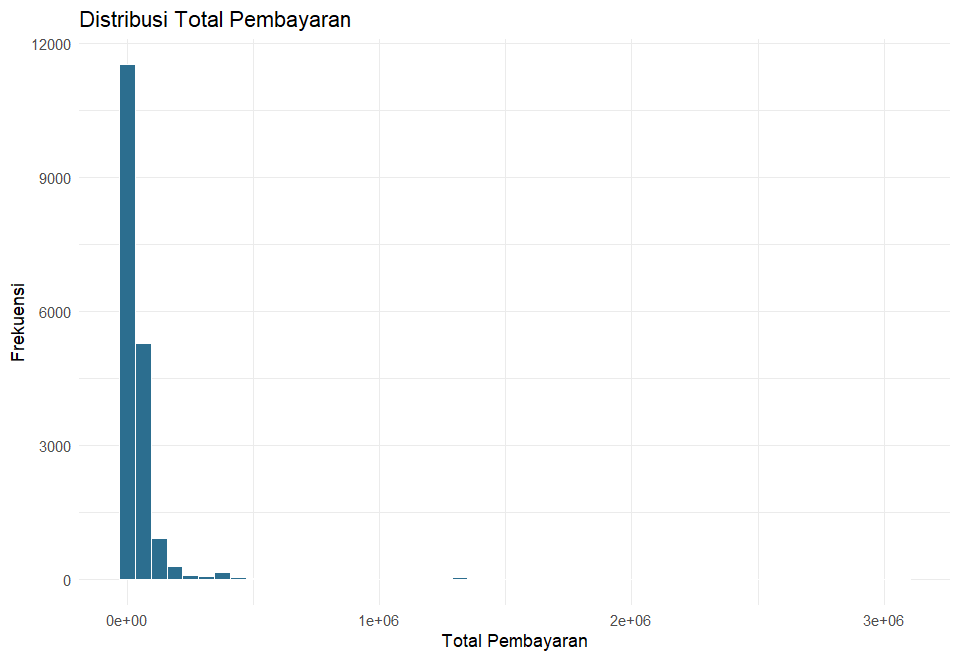
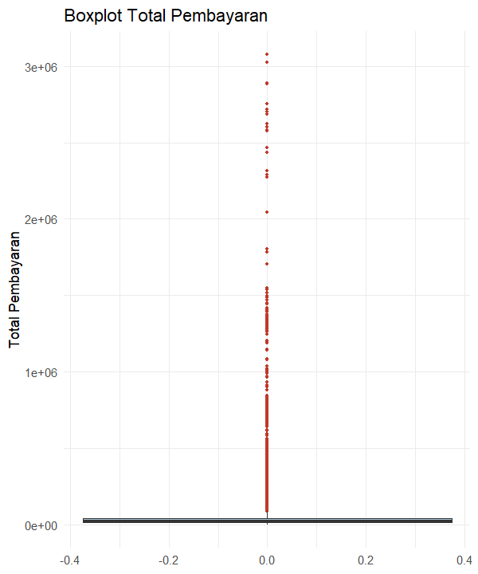
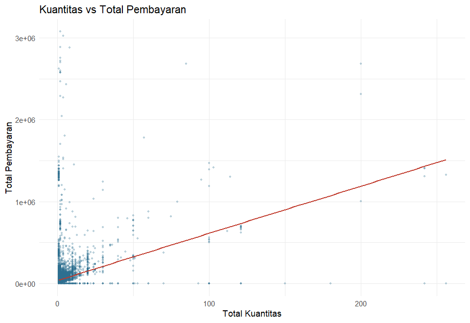
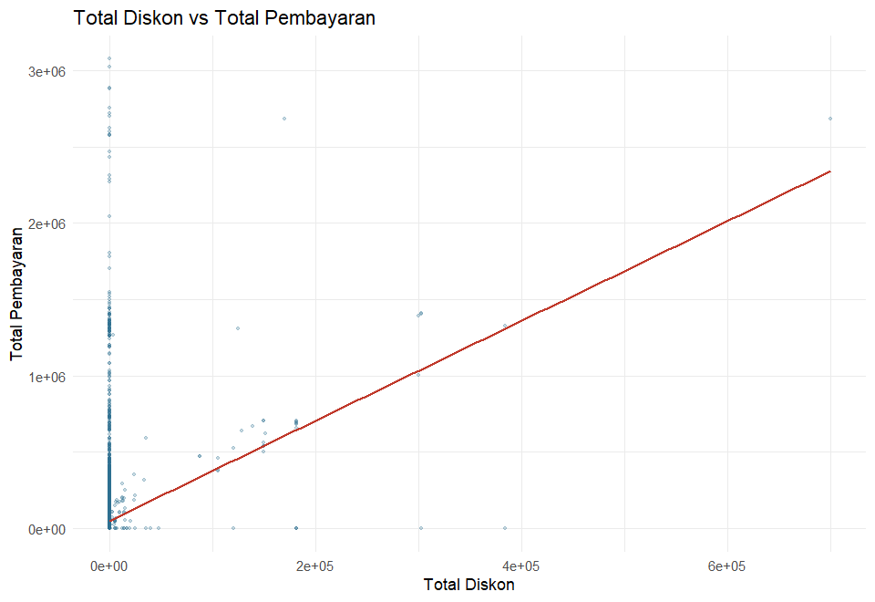
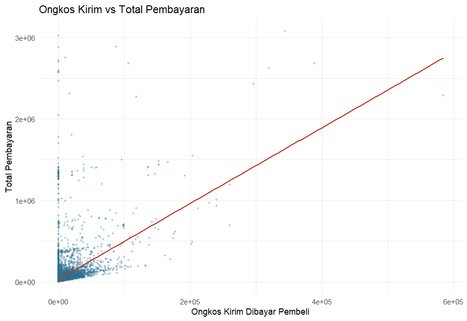
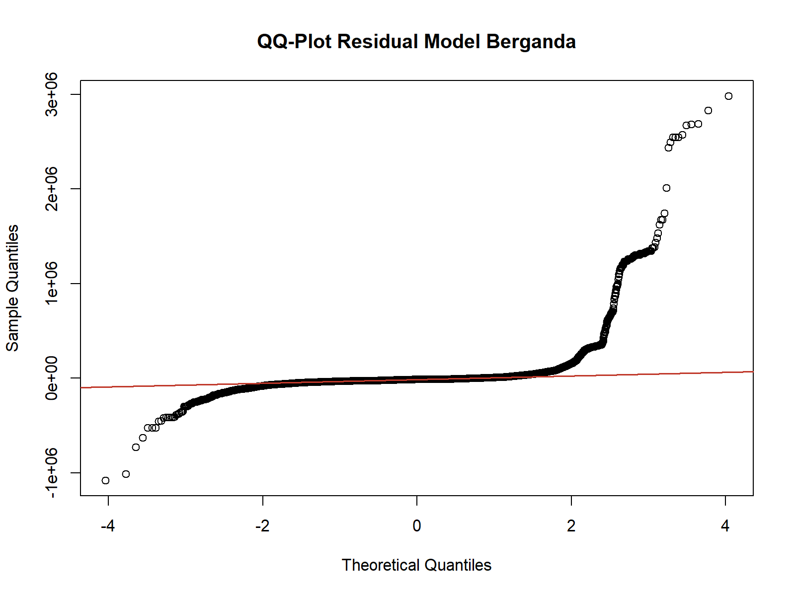
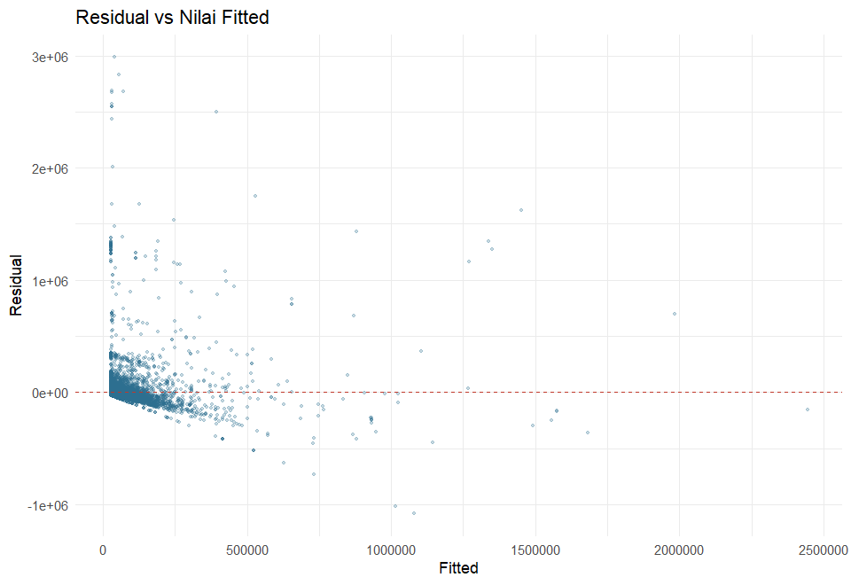

# Draft presentasi: Analisis regresi transaksi e-commerce Indonesia

Setiap slide memuat isi layar dan catatan demo. Path gambar dihitung relatif dari berkas `presentasi/slide.md`.

---

## Slide 1: Judul

**Isi slide**

- Analisis regresi total pembayaran pada transaksi e-commerce Indonesia
- Tugas Statistik, bidang Ekonomi dan Bisnis
- [Nama]
- [NIM]
- [Mata Kuliah], [Dosen], [Tanggal]

**Catatan demo**

- Buka slide ini, sebutkan bahwa unit analisisnya adalah transaksi, bukan konsumen.
- Identitas masih memakai placeholder dan akan diisi sebelum presentasi.

---

## Slide 2: Tujuan proyek dan topik

**Isi slide**

- Bidang: Ekonomi dan Bisnis, dengan fokus pada transaksi e-commerce Indonesia.
- Pertanyaan utama: variabel apa yang berkaitan dengan total pembayaran?
- Tujuan: mengukur hubungan total pembayaran dengan jumlah barang, diskon, dan ongkos kirim yang dibayar pembeli.
- Hasil akhir: perbandingan model regresi sederhana dan berganda, lalu tiga skenario prediksi di `output/tables/prediksi.csv`.

**Catatan demo**

- Tekankan bahwa analisis ini memakai data transaksi yang sudah tersedia, bukan survei baru.
- Sebut empat kolom model pada slide berikutnya sebelum masuk ke angka.

---

## Slide 3: Sumber data

**Isi slide**

- Dataset: Indonesia E-Commerce Sales, Kaggle `zkyfauzi/indonesia-ecommerce-sales`.
- Lisensi: CC0 Public Domain.
- URL: https://www.kaggle.com/datasets/zkyfauzi/indonesia-ecommerce-sales
- Ukuran awal: 18.868 baris dan 19 kolom.
- Berkas lokal: `data/raw/ec_indonesia.csv`.
- Metadata Kaggle menyebut dataset ini sebagai data latihan preprocessing, bukan data produksi real-time.

**Catatan demo**

- Tunjukkan `output/tables/provenance.txt` sebagai bukti sumber, lisensi, dan tanggal verifikasi.
- Jika dosen menanyakan ukuran berkas, sebut 3.620.891 byte sesuai metadata endpoint Kaggle.

---

## Slide 4: Preprocessing

**Isi slide**

- Nama kolom model diseragamkan, antara lain `Total Pembayaran` menjadi `total_pembayaran`.
- Kolom model dikonversi ke numerik; desimal memakai titik.
- Baris duplikat: 0.
- Baris dengan NA pada variabel model: 283, semuanya berasal dari `total_qty`.
- Baris final: 18.868 - 283 = 18.585.

**Catatan demo**

- Buka `output/analisis_log.txt` dan arahkan ke bagian "Jumlah NA per kolom" sampai "Jumlah baris final".
- Jelaskan bahwa penghapusan NA dilakukan setelah pengecekan duplikat, sehingga jumlah duplikat tetap 0.

---

## Slide 5: Variabel model

**Isi slide**

| Peran | Variabel dalam model | Median | SD |
|---|---|---:|---:|
| Y | Total Pembayaran | 21.800 | 143.140,09 |
| X1 | `total_qty` | 1 | 7,80 |
| X2 | Total Diskon (`total_diskon`) | 0 | 10.012,34 |
| X3 | Ongkos Kirim Dibayar oleh Pembeli (`ongkos_kirim_dibayar_oleh_pembeli`) | 0 | 13.941,24 |

**Catatan demo**

- Sebut pemetaan Y, X1, X2, X3 sekali di awal supaya pembaca tidak perlu menekan legenda grafik.
- Tunjukkan bahwa median diskon dan ongkos kirim bernilai 0, sehingga banyak transaksi tidak memuat dua komponen ini.

---

## Slide 6: Statistik deskriptif total pembayaran

**Isi slide**

- Mean: Rp50.997,58.
- Median: Rp21.800, modus: 0.
- SD: Rp143.140,09.
- Minimum: Rp0, maksimum: Rp3.076.000.
- Q1: Rp13.520, Q3: Rp42.288.
- Mean jauh di atas median dan nilai maksimum mencapai Rp3.076.000, sehingga distribusi condong ke kanan.

**Catatan demo**

- Tunjukkan histogram terlebih dahulu, lalu boxplot untuk memperlihatkan ekor kanan dan titik outlier.
- Rujuk angka di `output/tables/statistik_deskriptif.csv`.

---

## Slide 7: Korelasi Pearson

**Isi slide**

| Pasangan | Koefisien korelasi |
|---|---:|
| Y dengan X1 | 0.314 |
| Y dengan X2 | 0.229 |
| Y dengan X3 | 0.454 |
| X1 dengan X2 | 0.728 |

- X3 memiliki korelasi terbesar dengan Y, yaitu 0.454.
- X1 dan X2 berkorelasi 0.728, sehingga koefisien keduanya dalam model berganda perlu dibaca dengan hati-hati.

**Catatan demo**

- Tunjukkan tiga scatter plot secara berurutan sesuai urutan tabel korelasi.
- Garis merah pada tiap plot adalah garis regresi linear dari model sederhana yang bersesuaian.

---

## Slide 8: Regresi linear sederhana

**Isi slide**

- Model: Y = 36198.7 + 5767.4 X1.
- Slope X1: 5767.4, dengan t = 45.13 dan p < 2e-16.
- Intercept: 36198.7, dengan p < 2e-16.
- R²: 0.0988; R² adjusted: 0.09872.
- F = 2036, p < 2.2e-16.
- Setiap tambahan 1 unit `total_qty` berhubungan dengan tambahan Rp5.767,4 pada total pembayaran, tetapi model ini hanya menjelaskan 9,88% variasi Y.

**Catatan demo**

- Tunjukkan `output/tables/regresi_sederhana.txt`.
- Kembali ke `scatter_qty_y.png` saat menjelaskan slope dan sebaran titik.

---

## Slide 9: Regresi linear berganda

**Isi slide**

- Model: Y = 22990 + 3938 X1 + 0.125 X2 + 4.134 X3.
- R²: 0.2521; R² adjusted: 0.2520.
- F = 2088, p < 2.2e-16.
- X1 signifikan, p < 2e-16, koefisien 3938.
- X3 signifikan, p < 2e-16, koefisien 4.134.
- X2 tidak signifikan, p = 0.345, koefisien 0.125.
- R² naik dari 0.0988 menjadi 0.2521 setelah X2 dan X3 masuk, tetapi X2 tidak memberi bukti statistik pada model ini.

**Catatan demo**

- Tunjukkan `output/tables/regresi_berganda.txt`, khususnya kolom `Estimate` dan `Pr(>|t|)`.
- Jika ditanya soal X2, kaitkan dengan korelasi X1-X2 sebesar 0.728 pada slide 7.

---

## Slide 10: Evaluasi asumsi dan prediksi

**Isi slide**

- VIF: X1 2.188921, X2 2.125484, X3 1.056990. Semua lebih kecil dari 2.2.
- Normalitas residual ditolak: Shapiro-Wilk W = 0.27163, p < 2.2e-16, sampel acak n = 5000.
- Heteroskedastisitas terdeteksi: Breusch-Pagan BP = 218.91, df = 3, p < 2.2e-16.
- Prediksi memakai interval keyakinan 95%, tetapi dua asumsi di atas belum terpenuhi.

| Skenario | X1 | X2 | X3 | Prediksi Y (Rp) | Interval 95% (Rp) |
|---|---:|---:|---:|---:|---:|
| 1 | 1 | 0 | 0 | 26.931,69 | 25.034,71 - 28.828,67 |
| 2 | 1 | 0 | 3.000 | 39.333,51 | 37.495,79 - 41.171,23 |
| 3 | 2 | 0 | 0 | 30.869,41 | 29.005,93 - 32.732,90 |

**Catatan demo**

- Tunjukkan `output/tables/uji_asumsi.txt` sebelum `output/tables/prediksi.csv`.
- Akui keterbatasan model dengan terus terang: VIF aman, tetapi normalitas dan homogenitas varians residual tidak lolos uji.

---

## Slide 11: Cara demo di RStudio

**Isi slide**

- Pastikan working directory berada di root proyek `projek_uas` agar path relatif terbaca.
- Buka `R/analysis.R` di RStudio, lalu jalankan seluruh skrip dengan `Source` atau `Ctrl+Shift+Enter`.
- Tunjukkan `output/analisis_log.txt` untuk alur lengkap: 18.868 baris awal, 18.585 baris final, R², uji asumsi, dan prediksi.
- Tunjukkan `output/tables/statistik_deskriptif.csv`, `korelasi.csv`, `regresi_sederhana.txt`, `regresi_berganda.txt`, `uji_asumsi.txt`, dan `prediksi.csv`.
- Tunjukkan `output/plots/*.png` sesuai slide 6, 7, dan 10.

**Catatan demo**

- Jalankan skrip sekali di depan kelas, lalu memakai hasil yang sudah tersimpan untuk mempercepat sesi tanya jawab.
- Jika ada pesan paket hilang, pasang `ggplot2`, `car`, dan `lmtest` sebelum demo.

---

## Slide 12: Pertanyaan yang mungkin muncul

**Isi slide**

- **Mengapa X2 tidak signifikan?** Koefisiennya 0.125 dengan p = 0.345. Korelasi X1-X2 sebesar 0.728 membuat kontribusi keduanya saling berdekatan.
- **Apakah model berganda layak?** F = 2088 dengan p < 2.2e-16 dan R² = 0.2521. Namun 74,79% variasi total pembayaran masih berada di luar model.
- **Apakah asumsi regresi terpenuhi?** VIF semua di bawah 2.2, tetapi Shapiro-Wilk dan Breusch-Pagan memberi p < 2.2e-16, sehingga normalitas dan homogenitas varians residual ditolak.
- **Mengapa mean jauh di atas median?** Mean Rp50.997,58, median Rp21.800, dan maksimum Rp3.076.000. Beberapa transaksi bernilai sangat besar menarik mean ke kanan.
- **Bolehkah angka prediksi dipakai?** Sebagai ilustrasi model, ya. Skenario 2 memberi Rp39.333,51 dengan interval Rp37.495,79 sampai Rp41.171,23, tetapi interpretasinya tetap dibatasi oleh R² dan hasil uji asumsi.

**Catatan demo**

- Jawab dengan menyebut angka terlebih dahulu, lalu artinya.
- Hindari klaim sebab akibat. Seluruh koefisien dibaca sebagai hubungan dalam data, bukan efek perlakuan.

---

## Lampiran aset plot

- `../output/plots/hist_y.png`
- `../output/plots/box_y.png`
- `../output/plots/scatter_qty_y.png`
- `../output/plots/scatter_diskon_y.png`
- `../output/plots/scatter_ongkir_y.png`
- `../output/plots/qq_plot.png`
- `../output/plots/residual_vs_fitted.png`
